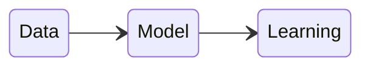

### What is the Mathematics for Machine Learning Book About?
[Book url](https://iamprasadraju.github.io/ResearchRack/books/mathematics-for-machine-learning-1777020629)

**Machine learning** is about designing algorithms that automatically extract
valuable information from data.

<blockquote>
    <b>The goal is to find good models that generalize well to yet unseen data.</b>
</blockquote>

## How Are Vectors Used in Machine Learning?

Any data represented as **`vectors`**.

Three ways to think about **vectors**:

- a vector as an **array of numbers** (a
computer science view)

-  a vector as an **arrow with a direction and magnitude** (a physics view)

-  a vector as an object that obeys **addition and scaling** (a mathematical view)

## How Do Machine Learning Models Learn From Data?

Learning component of machine learning - **Training the model** means to use the data available to **optimize** (**gradient descent**)  some parameters of the model with respect to a **utility function** (**loss function**)  that evaluates how well the model predicts the training data.

$^{*}\text{Note:}$  Performing well on data that
we have already seen (**training data**) may only mean that we found a
good way to **memorize** the data. 

### What Are the Core Mathematical Pillars of Machine Learning?

**Linear algebra** - The study of vectors and matrices is called linear algebra. 
Numerical data as vectors and represent a table of such
data as a matrix. 

Vectors and matrices represent datasets, features, and model parameters in ML algorithms like neural networks. Key operations include **matrix multiplication**, **inversion**, **eigenvalues/eigenvectors** (used in **PCA** for dimensionality reduction), and **projections** (essential for **SVM**).

**Calculus** - Gradients and partial derivatives enable optimization techniques like **gradient descent** to minimize **loss functions**. Concepts like **chain rule** and **Jacobian matrices** support **backpropagation** in deep learning.

**Probability and Statistics** - These handle uncertainty, data distributions, and inference. Core ideas include **probability distributions**, **Bayes' theorem**, **maximum likelihood estimation (MLE)**, **hypothesis testing**, **bias-variance tradeoff**, and metrics like **mean squared error**.

**Optimization** - Techniques such as gradient descent variants (e.g., **stochastic**, **Adam**) rely on calculus to iteratively update model weights. **Convex optimization** ensures reliable convergence in many ML problems.
